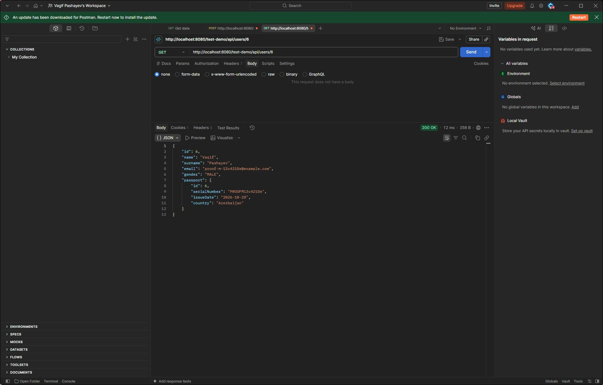
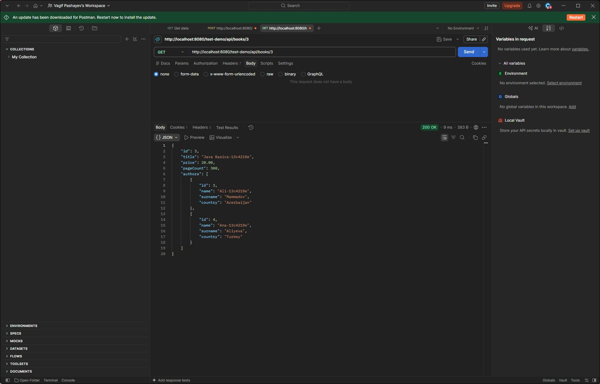

# SPRING-Task-4

Spring Boot və Spring Data JPA ilə REST API. User/Passport, Department/Employee,
Student/Course və Author/Book əlaqələri üzərində CRUD əməliyyatları.

## Başlatmaq

Java 25 və Docker Desktop lazımdır. Spring Boot 4.1.2, PostgreSQL 16,
Gradle wrapper, Lombok və MapStruct 1.6.3 istifadə olunur.

İlk dəfə:

```powershell
Copy-Item .env.example .env
docker compose up -d --wait
.\gradlew.bat test
.\gradlew.bat bootRun
```

Linux/macOS-da Gradle əmrləri `./gradlew test` və `./gradlew bootRun` şəklindədir.
IntelliJ-də Gradle JVM olaraq Java 25 seçin. Main class: `SchoolApplication`.
Terminal üçün `JAVA_HOME` da Java 25-ə yönəlməlidir.

Baza ünvanı: `http://localhost:8080/test-demo/api`.

## PostgreSQL

| Parametr | Dəyər |
|---|---|
| Konteyner | school-postgres |
| Host / port | localhost:5432 |
| Database | school_db |
| User | postgres |
| Password | .env daxilində POSTGRES_PASSWORD |
| Volume | spring-task-4-school-data |

`.env.example` lokal dərs mühiti üçün nümunədir, `.env` Git-ə daxil edilmir.
Konteyner portu yalnız `127.0.0.1`-ə bağlanıb. `docker compose down` konteyneri
dayandırır, volume saxlanılır.

Konfiqurasiya: `ddl-auto: update`, `show-sql: true`, `open-in-view: false`.
DTO-lar servis tranzaksiyasında hazırlanır. Detail sorğularında JOIN FETCH,
user siyahısı və salary-range üçün EntityGraph istifadə olunur.

## Endpoint-lər

Aşağıdakı yollar `/test-demo` context path-dən sonradır.
POST əməliyyatları 201, DELETE əməliyyatları 204 qaytarır.
Tapılmayan obyekt 404, biznes konflikti 409, səhv parametr 400 qaytarır.

### User / Passport

| Metod | Yol |
|---|---|
| POST | /api/users |
| GET | /api/users |
| GET | /api/users?gender=MALE |
| GET | /api/users/{id} |
| GET | /api/users/by-email?email=ali@example.com |
| GET | /api/users/without-passport |
| PUT / DELETE | /api/users/{id} |
| POST / GET / DELETE | /api/users/{id}/passport |

User request: `name, surname, email, gender`. JSON-da gender `MALE` və ya
`FEMALE`, bazada isə converter vasitəsilə 1 və ya 2 saxlanılır.
Passport request: `serialNumber, issueDate, country`; tarix `yyyy-MM-dd` formatındadır.
Email və passport serialı unikaldır. İkinci passport əlavə etmək olmaz.
Passport əlaqəsi kəsiləndə orphanRemoval işləyir; user silinəndə passport da silinir.

### Department / Employee

| Metod | Yol |
|---|---|
| POST / GET | /api/departments |
| GET | /api/departments/{id} |
| GET | /api/departments/without-employees |
| PUT / DELETE | /api/departments/{id} |
| POST | /api/employees |
| GET / PUT / DELETE | /api/employees/{id} |
| GET | /api/employees/department/{departmentId} |
| GET | /api/employees/salary-range?min=500&max=2000 |
| GET | /api/employees/department/{id}/average-salary |

Department request: `name, location, phone`.
Employee request: `name, surname, salary, departmentId`.
Şöbə adı unikaldır. Eyni şöbədə eyni ad-soyadlı işçi təkrarlana bilməz.
İşçisi olan şöbəni silmək olmaz. İşçi silinəndə şöbə qalır.
Maaş aralığı hər iki sərhədi daxil edir; min > max olduqda 400 qaytarılır.
Boş şöbənin orta maaş cavabı 0.0-dır.

### Student / Course

| Metod | Yol |
|---|---|
| POST / GET | /api/students |
| GET / PUT / DELETE | /api/students/{id} |
| GET | /api/students/without-courses |
| POST / DELETE | /api/students/{studentId}/courses/{courseId} |
| POST / GET | /api/courses |
| GET / PUT / DELETE | /api/courses/{id} |
| GET | /api/courses/student/{studentId} |
| GET | /api/courses/{id}/students |
| GET | /api/courses/{id}/students/count |

Student request: `name, surname, age`.
Course request: `title, credit, teacher`.
Student əlaqənin owner tərəfidir. Təkrar enroll və mövcud olmayan qeydiyyatın
unenroll edilməsi qadağandır. Student silinəndə kurslar qalır. Kurs silinməzdən
əvvəl əlaqələr student tərəfindən qırılır, tələbələr silinmir.
StudentResponse.courses yalnız detail cavabında doldurulur.

### Author / Book

| Metod | Yol |
|---|---|
| POST / GET | /api/authors |
| GET | /api/authors?country=Azerbaijan |
| GET / PUT / DELETE | /api/authors/{id} |
| GET | /api/authors/without-books |
| GET | /api/authors/{id}/books |
| POST / GET | /api/books |
| GET | /api/books?title=java |
| GET / PUT / DELETE | /api/books/{id} |
| GET | /api/books/cheaper-than?price=20 |
| POST / DELETE | /api/books/{bookId}/authors/{authorId} |

Author request: `name, surname, country`.
Book request: `title, price, pageCount`.
Əlaqə ayrıca AuthorBook entity-si ilə saxlanılır. Təkrar author-book cütü
qadağandır. Müəllif və ya kitab silinəndə yalnız əlaqələri silinir,
qarşı tərəfdəki entity qalır. BookResponse.authors yalnız detail cavabında doldurulur.
Başlıq axtarışı hərf registrindən asılı deyil. Qiymət filteri <= və artan sıradır.

## Postman və yoxlama

[Postman kolleksiyası](postman/SPRING-Task-4.postman_collection.json) faylını import edin.
`baseUrl` dəyişəni hazırdır. Run zamanı bütün dörd qovluğu sıra ilə seçin:
əvvəlki sorğuların yaratdığı ID-lər sonrakı sorğularda istifadə olunur.

Kolleksiya unikal test məlumatları yaradır və sonda onları silir.
111 sorğu və 142 assertion yoxlanılıb, uğursuz nəticə yoxdur.
Komanda sətrindən işlətmək üçün Node.js və Newman istifadə edilə bilər:

```text
npx newman run postman/SPRING-Task-4.postman_collection.json
```

[Əlaqə yoxlamaları və ekran görüntüləri](docs/REPORT.md).
[SQL və HTTP nəticələri](docs/verification-results.txt).
[JOIN FETCH SQL çıxışı](docs/join-fetch.log).

### User və passport



### Kitab və müəlliflər


