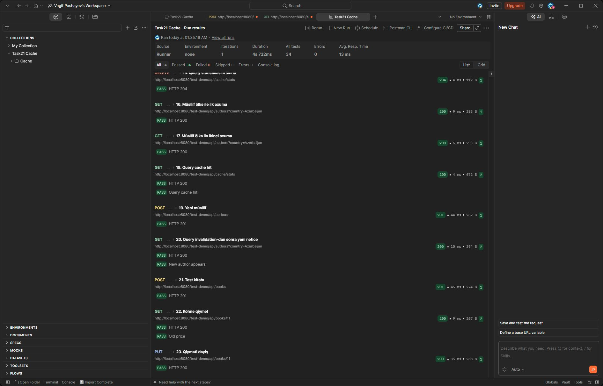
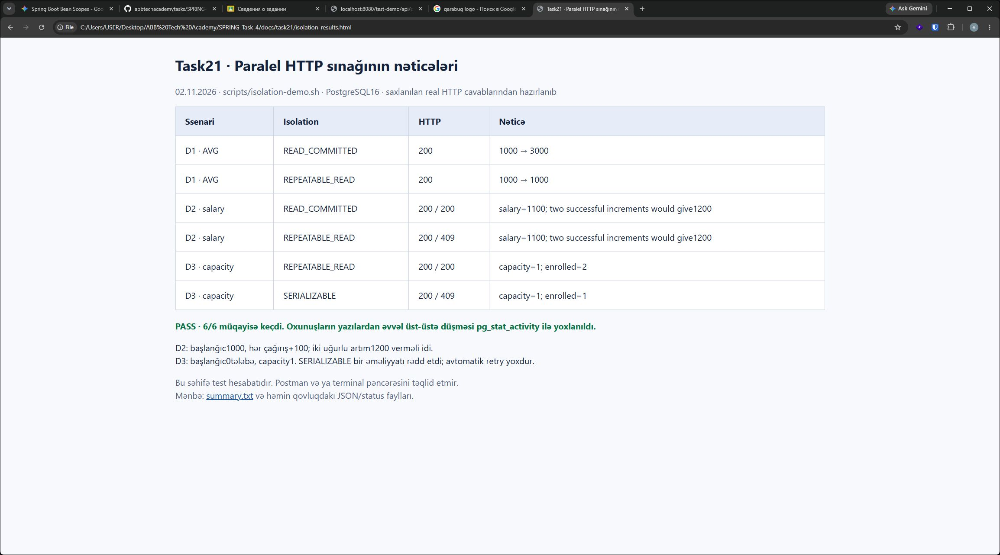
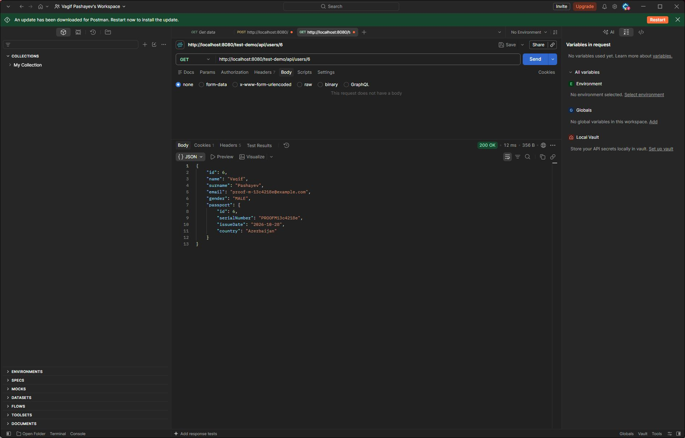
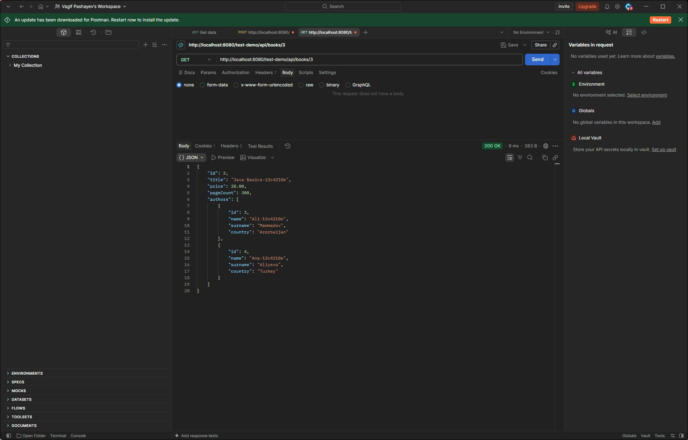

# SPRING-Task-4

Task23: [hesabat, PR-lər və Swagger ekran görüntüləri](docs/task23/README.md).

Swagger: http://localhost:8080/test-demo/swagger-ui.html

Task21 üçün Liquibase yoxlamaları və ekran görüntüləri: [hesabat](docs/task21/REPORT.md).

Spring Boot və Spring Data JPA ilə REST API. User/Passport, Department/Employee,
Student/Course və Author/Book əlaqələri üzərində CRUD əməliyyatları.

## Başlatmaq

Java 25 və Docker Desktop lazımdır. Spring Boot 4.1.2, PostgreSQL 16,
Gradle wrapper, Lombok və MapStruct 1.6.3 istifadə olunur.

İlk dəfə:

```powershell
Copy-Item .env.example .env
docker compose up -d --wait
docker exec school-postgres createdb -U postgres school_task21_cache_checks
.\gradlew.bat test
.\gradlew.bat bootRun
```

Linux/macOS-da Gradle əmrləri `./gradlew test` və `./gradlew bootRun` şəklindədir.
IntelliJ-də Gradle JVM olaraq Java 25 seçin. Main class: `SchoolApplication`.
Terminal üçün `JAVA_HOME` da Java 25-ə yönəlməlidir.
Test bazası artıq varsa `createdb` əmrini təkrarlamayın. Köhnə volume-da school_task21_db yoxdursa,
onu da `docker exec school-postgres createdb -U postgres school_task21_db` ilə bir dəfə yaradın.

Baza ünvanı: `http://localhost:8080/test-demo/api`.

## PostgreSQL

| Parametr | Dəyər |
|---|---|
| Konteyner | school-postgres |
| Host / port | localhost:5432 |
| Database | school_task21_db |
| User | postgres |
| Password | .env daxilində POSTGRES_PASSWORD |
| Volume | spring-task-4-school-data |

`.env.example` lokal dərs mühiti üçün nümunədir, `.env` Git-ə daxil edilmir.
Konteyner portu yalnız `127.0.0.1`-ə bağlanıb. `docker compose down` konteyneri
dayandırır, volume saxlanılır.

Konfiqurasiya: `ddl-auto: validate`, `show-sql: true`, `open-in-view: false`. Sxemi Liquibase yaradır, Hibernate isə entity-lərlə uyğunluğunu yoxlayır.
DTO-lar servis tranzaksiyasında hazırlanır. Detail sorğularında JOIN FETCH,
user siyahısı və salary-range üçün EntityGraph istifadə olunur.

## Endpoint-lər

Aşağıdakı yollar `/test-demo` context path-dən sonradır.
POST əməliyyatları 201, DELETE əməliyyatları 204 qaytarır.
Tapılmayan obyekt 404, biznes konflikti 409, səhv parametr 400 qaytarır.

### User / Passport

| Metod | Yol |
|---|---|
| POST | /api/users |
| GET | /api/users |
| GET | /api/users?gender=MALE |
| GET | /api/users/{id} |
| GET | /api/users/by-email?email=ali@example.com |
| GET | /api/users/without-passport |
| PUT / DELETE | /api/users/{id} |
| POST / GET / DELETE | /api/users/{id}/passport |

User request: `name, surname, email, gender`. JSON-da gender `MALE` və ya
`FEMALE`, bazada isə converter vasitəsilə 1 və ya 2 saxlanılır.
Passport request: `serialNumber, issueDate, country`; tarix `yyyy-MM-dd` formatındadır.
Email və passport serialı unikaldır. İkinci passport əlavə etmək olmaz.
Passport əlaqəsi kəsiləndə orphanRemoval işləyir; user silinəndə passport da silinir.

### Department / Employee

| Metod | Yol |
|---|---|
| POST / GET | /api/departments |
| GET | /api/departments/{id} |
| GET | /api/departments/without-employees |
| PUT / DELETE | /api/departments/{id} |
| POST | /api/employees |
| GET / PUT / DELETE | /api/employees/{id} |
| GET | /api/employees/department/{departmentId} |
| GET | /api/employees/salary-range?min=500&max=2000 |
| GET | /api/employees/department/{id}/average-salary |

Department request: `name, location, phone`.
Employee request: `name, surname, salary, departmentId`.
Şöbə adı unikaldır. Eyni şöbədə eyni ad-soyadlı işçi təkrarlana bilməz.
İşçisi olan şöbəni silmək olmaz. İşçi silinəndə şöbə qalır.
Maaş aralığı hər iki sərhədi daxil edir; min > max olduqda 400 qaytarılır.
Boş şöbənin orta maaş cavabı 0.0-dır.

### Student / Course

| Metod | Yol |
|---|---|
| POST / GET | /api/students |
| GET / PUT / DELETE | /api/students/{id} |
| GET | /api/students/without-courses |
| POST / DELETE | /api/students/{studentId}/courses/{courseId} |
| POST / GET | /api/courses |
| GET / PUT / DELETE | /api/courses/{id} |
| GET | /api/courses/student/{studentId} |
| GET | /api/courses/{id}/students |
| GET | /api/courses/{id}/students/count |

Student request: `name, surname, age`.
Course request: `title, credit, teacher`.
Student əlaqənin owner tərəfidir. Təkrar enroll və mövcud olmayan qeydiyyatın
unenroll edilməsi qadağandır. Student silinəndə kurslar qalır. Kurs silinməzdən
əvvəl əlaqələr student tərəfindən qırılır, tələbələr silinmir.
StudentResponse.courses yalnız detail cavabında doldurulur.

### Author / Book

| Metod | Yol |
|---|---|
| POST / GET | /api/authors |
| GET | /api/authors?country=Azerbaijan |
| GET / PUT / DELETE | /api/authors/{id} |
| GET | /api/authors/without-books |
| GET | /api/authors/{id}/books |
| POST / GET | /api/books |
| GET | /api/books?title=java |
| GET / PUT / DELETE | /api/books/{id} |
| GET | /api/books/cheaper-than?price=20 |
| POST / DELETE | /api/books/{bookId}/authors/{authorId} |

Author request: `name, surname, country`.
Book request: `title, price, pageCount`.
Əlaqə ayrıca AuthorBook entity-si ilə saxlanılır. Təkrar author-book cütü
qadağandır. Müəllif və ya kitab silinəndə yalnız əlaqələri silinir,
qarşı tərəfdəki entity qalır. BookResponse.authors yalnız detail cavabında doldurulur.
Başlıq axtarışı hərf registrindən asılı deyil. Qiymət filteri <= və artan sıradır.

## Liquibase CLI

Komandaları layihənin kökündə işlədin. Compose parolu `.env` faylından oxuyur.
`tools` profili yalnız CLI üçündür; adi `docker compose up -d` onu başlatmır.

```text
docker compose --profile tools build liquibase
docker compose --profile tools run --rm liquibase status --verbose
docker compose --profile tools run --rm liquibase rollback-sql --tag=v1.0
```

Real rollback-dən əvvəl tətbiqi dayandırın və bazanın ehtiyat nüsxəsini saxlayın.
Bu layihədə v1.0-dan sonra capacity, audit_logs və dev seed əlavə olunub;
rollback onları geri götürür. Sonra update ilə yenidən tətbiq edin və tətbiqi başladın:

```text
docker compose --profile tools run --rm liquibase rollback --tag=v1.0
docker compose --profile tools run --rm liquibase update
docker compose --profile tools run --rm liquibase status --verbose
```

CLI image Liquibase 5.0.4 və PostgreSQL driver ilə yığılır.
Changelog read-only mount edilir, dev context Compose-da təyin olunub.
`tagDatabase` changeSet-i rollback zamanı tarixçədən çıxır; update onu da qaytarır.
[Task21 sınaqlarının nəticələri və şəkilləri](docs/task21/REPORT.md).

`databasechangeloglock` eyni bazada iki Liquibase prosesinin miqrasiyaları eyni vaxtda icra etməsinin qarşısını alır.
Proses lock-u alır, dəyişiklikləri tətbiq edir və sonra azad edir. Proses qəfil dayansa, lock-u silməzdən əvvəl
başqa migration prosesinin işləmədiyini yoxlamaq lazımdır.

Komandada Hibernate-in avtomatik sxem dəyişməsi versiyalanmış migration və əvvəlcədən nəzərdən keçirilən SQL vermir;
müxtəlif bazalar fərqli vəziyyətə düşə bilər. Liquibase ardıcıllığı, icra tarixçəsini və checksum-u saxlayır.
Yeni dəyişiklik yeni changeSet-dir; tətbiq edilmiş fayl dəyişdirilmir. Hibernate validate bütün FK/check qaydalarını
tam yoxlamır: constraint-lər ayrıca PostgreSQL kataloqundan da yoxlanılıb.

## Task21: Hibernate cache

Course, Department, Author və AuthorBook READ_WRITE, Book NONSTRICT_READ_WRITE ilə cache-lənir.
Author.authorBooks və Book.authorBooks ayrıca collection region-larında saxlanılır.
User, Passport, Employee, Student və AuditLog cache-lənmir.

| Metod | Yol | Əməliyyat |
|---|---|---|
| GET | /api/cache/stats | Ümumi və region statistikası |
| DELETE | /api/cache | Entity, collection və query region-larını təmizləyir |
| DELETE | /api/cache/{region} | Bir entity sinfinin cache-ni təmizləyir |
| DELETE | /api/cache/stats | Yalnız sayğacları sıfırlayır |

Entity region adları: courses, departments, authors, books, author-books. Naməlum ad 400 qaytarır.
Ehcache XML resources qovluğundadır; Hibernate uri=ehcache.xml ilə onu classpath-dən tapır.
Course/Department TTL 10 dəqiqə, Book 2 dəqiqədir. Update timestamps region-u expiry olmadan saxlanılır.

L1 bir persistence context daxilində işləyir və həmin context bağlanana/clear edilənə qədər yaşayır.
L2 SessionFactory daxilində context-lər arasında paylaşılır; qeydlər TTL, eviction, invalidation və ya tətbiqin bağlanması ilə çıxır.
READ_ONLY dəyişməyən məlumat üçündür; dəyişiklik dəstəkləmir. READ_WRITE cache yazılarını soft lock ilə əlaqələndirir.
NONSTRICT_READ_WRITE qısa müddət köhnə nəticəni qəbul edir və update zamanı invalidation edir.
Book üçün bu seçim tapşırığın tələbidir; real qiymət qaydaları köhnə qiyməti qəbul etmirsə, daha güclü yanaşma seçilməlidir.

Query cache parametrli sorğunun nəticəsini saxlayır. Entity cache onunla eyni şey deyil:
identifier əsaslı nəticə olduqda entity məlumatı L2-dən, orada yoxdursa DB-dən yüklənir.
Hibernate versiyası və query cache layout-dan asılı olaraq nəticədə entity vəziyyəti də saxlanıla bilər;
ona görə entity cache olmadan həmişə eyni sayda əlavə SQL olacağını güman etmək olmaz.
Bu layihədə findAllByCountry ayrıca cacheable işarələnib. Hibernate vasitəsilə author yazısı query nəticəsini etibarsız edir.
Birbaşa xarici SQL dəyişikliklərini L2 avtomatik izləmir.

Cache qovluğunu əsas Postman kolleksiyasında ayrıca run edin və ya
[Task21 Cache kolleksiyasını](postman/Task21-Cache.postman_collection.json) import edin.
26 sorğu və 34 assertion uğurla yoxlanılıb:



```text
npx newman run postman/Task21-Cache.postman_collection.json
```

Collection cache və @Modifying bulk update üçün JUnit yoxlamaları ayrıca school_task21_cache_checks bazasında işləyir.
Bu bazanı ilk dəfə yaradın; mövcuddursa createdb əmrini təkrarlamaq lazım deyil:

```text
docker exec school-postgres createdb -U postgres school_task21_cache_checks
.\gradlew.bat test --tests "*CacheIntegrationTests"
```

Dörd test uğurludur: L2 vs JOIN FETCH, hər iki collection cache, bulk update region invalidation,
NONSTRICT_READ_WRITE Book update. [Nəticələr](docs/task21/cache-integration-summary.txt).

## Task21: REQUIRED transfer

POST /api/employees/{id}/transfer body:

```json
{"departmentId": 2, "raisePercent": 15}
```

EmployeeService şöbəni dəyişir, SalaryService maaşı hesablayır. İki metod eyni REQUIRED tranzaksiyasındadır.
Maaş10000-dən çox olarsa409 qaytarılır və şöbə dəyişikliyi də rollback olur. Dəqiq10000 qəbul olunur.
Transactions/C1 REQUIRED qovluğu və ayrıca [Transactions kolleksiyası](postman/Task21-Transactions.postman_collection.json)
11request/17assertion ilə yoxlanılıb. [Nəticələr və log](docs/task21/REPORT.md).

### REQUIRES_NEW audit

AuditLogService.log ayrıca tranzaksiyada audit_logs-a yazır. Maaş limiti keçəndə əsas transfer rollback olsa da FAILED qalır.
Müvəqqəti REQUIRED müqayisəsində həmin FAILED sətri də rollback oldu; yekun kod REQUIRES_NEW-a qaytarılıb.
Testlər ayrıca school_task21_cache_checks bazasında işləyir:

```text
.\gradlew.bat test --tests "*PropagationIntegrationTests"
```

REQUIRES_NEW zamanı xarici tranzaksiya connection-u saxlayır, audit əlavə connection tələb edir.
Çox paralel çağırış və kiçik pool connection çatışmazlığına səbəb ola bilər.
Spring default rollback RuntimeException/Error üçündür; checked exception üçün lazım olduqda rollbackFor yazılır.
Daxili REQUIRED ümumi tranzaksiyanı rollback-only etdikdən sonra xarici metod xətanı udub commit etməyə çalışarsa
UnexpectedRollbackException ala bilər. [C2 müqayisəsi və sübutlar](docs/task21/REPORT.md).

### MANDATORY qeydiyyat yoxlaması

StudentService.enroll mövcud REQUIRED tranzaksiyası içindən EnrollmentService.reserveSeat çağırır.
Yer yoxdursa409 Course is full qaytarılır. reserveSeat özü qeydiyyat yaratmır.
POST /api/tx-demo/reserve-seat/{courseId} controller-dən tranzaksiyasız çağırıldığı üçün409 qaytarır.
Transactions/C3 MANDATORY qovluğu12request/19assertion/0failure ilə yoxlanılıb:

```text
npx newman run postman/Task21-Transactions.postman_collection.json --folder "C3 MANDATORY"
```

Demo seed Course1 capacity1 və boş qeydiyyat siyahısı tələb edir. Sınaq yeni tələbələr yaradır və sonda silir.

### Self-invocation

this.raise çağırışı Spring proxy-dən keçmir. Müvəqqəti REQUIRES_NEW metod eyni EmployeeService daxilində
çağırılanda yeni tranzaksiya açılmadı; inner və outer transaction adı EmployeeService.transfer olaraq qaldı.
Sınaqdan sonra ayrı SalaryService variantı bərpa edildi. [Sübutlar](docs/task21/REPORT.md).

Adi hesablama və yoxlama helper-lərini eyni sinifdə çağırmaq olar. Ayrı transactional sərhəd lazım olduqda
ayrı bean çağırışı və ya TransactionTemplate kimi açıq transaction idarəsi istifadə edilməlidir.

## Task21: Isolation D1

GET /api/isolation/departments/{id}/salary-report?isolation=READ_COMMITTED&delayMs=5000
iki avg nəticəsini qaytarır. REPEATABLE_READ də dəstəklənir; delay0..15000ms-dir.
Paralel PUT maaşı1000->3000 dəyişdirəndə READ_COMMITTED1000/3000, REPEATABLE_READ1000/1000 qaytardı.
Entity əvəzinə aggregate avg istifadə olunur ki,L1 eyni entity-ni qaytarıb fərqi gizlətməsin.
[Paralel nəticələr](docs/task21/d1-parallel-results.json), [Postman Isolation kolleksiyası](postman/Task21-Isolation.postman_collection.json).
Postman-dakı D1 qovluğu ardıcıl smoke testidir; real paralel fərq ayrıca HTTP sınağında yoxlanılıb.

### Isolation D2

POST /api/isolation/employees/{id}/raise?amount=100&isolation=READ_COMMITTED&delayMs=5000
maaşı əvvəl oxuyur, gözləyir və oxunan dəyərə amount əlavə edir. REPEATABLE_READ də dəstəklənir.
Eyni salary1000 üçün iki paralel +100:RC iki200 və son1100,lost update;RR bir200/bir409 və son1100.
RR rədd etdiyi əməliyyatı avtomatik tətbiq etmir;tam tranzaksiya yenidən sınanmalıdır.
[Paralel nəticələr](docs/task21/d2-parallel-results.json).

### Isolation D3

POST /api/isolation/courses/{courseId}/enroll/{studentId}?isolation=REPEATABLE_READ&delayMs=5000
əvvəl qeydiyyat sayını yoxlayır, gözləyir və tələbəni kursa yazır. SERIALIZABLE də dəstəklənir.
Capacity1 olan boş kursa iki ayrı tələbə paralel yazıldı: RR iki200 və iki qeydiyyat verdi (write skew).
SERIALIZABLE bir200/bir409 və bir qeydiyyat verdi. Hər iki ilkin count=0 oxunuşu yazılardan əvvəl təsdiqlənib.
409 avtomatik retry demək deyil. Yeni tranzaksiyada təkrar əməliyyat artıq dolu kursu görər.
[Paralel nəticələr](docs/task21/d3-parallel-results.json), [xülasə](docs/task21/d3-summary.txt).
Postman D3 qovluğu ardıcıl smoke testidir:11request/13assertion/0failure; paralel sınağı əvəz etmir.

### Paralel demo skripti

Tətbiq və Docker işləyərkən layihənin kökündə Git Bash/Linux/macOS terminalında:

```bash
bash scripts/isolation-demo.sh
```

`curl`, `node` və `docker` PATH-də olmalıdır. Skript təxminən40 saniyə çəkir, D1/D2/D3 üçün hər iki isolation-u
işlədir. `pg_stat_activity` ilə ilk oxunuşların yazılardan əvvəl baş verdiyini təsdiqləyir; üst-üstə düşmə yoxdursa
sınaq uğurlu sayılmır. Status və DB nəticəsi gözlənilənə uyğun deyilsə exit code sıfır olmur.
Yeni şöbə, işçi və tələbələr yaradılır, sonda silinir. Seed course1 capacity1 və boş olmalıdır;
eyni anda başqa enroll sınağı işlətməyin. Başqa bazanı yoxlamaq üçün BASE, DATABASE, CONTAINER dəyişənləri mövcuddur.
HTTP JSON və statuslar `build/isolation-demo/<run>/` altında qalır. [Son run](docs/task21/isolation-demo/summary.txt).



| Ssenari | Zəif səviyyə | Daha güclü səviyyə |
|---|---|---|
| D1 | RC: AVG1000 ->3000 | RR: AVG1000 ->1000 |
| D2 | RC:200/200,maaş1100 | RR:200/409,maaş1100 |
| D3 | RR:200/200,capacity1 üçün2tələbə | SERIALIZABLE:200/409,1tələbə |

PostgreSQL READ_UNCOMMITTED səviyyəsini READ_COMMITTED kimi icra edir; başqa tranzaksiyanın commit edilməmiş
yazısını oxuya bilmirik. PostgreSQL REPEATABLE_READ sabit snapshot sayəsində phantom read-i də aradan qaldırır;
SQL standartının minimum RR zəmanəti bunu tələb etmir. Bununla belə write skew mümkündür.
[PostgreSQL16 izahı](https://www.postgresql.org/docs/16/transaction-iso.html).

### D2-ni isolation dəyişmədən düzəltmək

`@Version Long version` optimistic locking əlavə edər: Hibernate UPDATE zamanı əvvəl oxunan version-u WHERE-ə
daxil edir, dəyişmiş sətri səssiz əzmək əvəzinə konflikt qaytarır. Oxu müddətində exclusive row lock saxlamır;
münaqişə olduqda bütün əməliyyatı yeni tranzaksiyada yenidən hesablamaq lazımdır.
PESSIMISTIC_WRITE isə sətri oxuyanda DB lock alır; başqa writer gözləyir. Daha çox gözləmə, timeout və deadlock riski var.
READ_COMMITTED-də ikinci writer lock-u aldıqdan sonra son maaş üzərindən hesablayar.
[Hibernate locking](https://docs.hibernate.org/orm/7.1/introduction/html_single/#optimistic-and-pessimistic-locking).

Bu iki variant D2-nin alternativ həllidir; tələb olunan anomaliyanı göstərmək üçün Employee-yə əlavə edilməyib.
Təkcə Student üzərində @Version D3-ü həll etmir: tələbələr fərqlidir. D3 üçün hamının eyni Course sətrini
lock edib sonra count yoxlaması etməsi və ya SERIALIZABLE kimi ümumi qaydanı qoruyan yanaşma lazımdır.

## Postman və yoxlama

### Task21 bonusları: NESTED və retry

Bonuslar da əlavə olunub: `POST /api/students/{id}/courses/bulk` dolu kursu savepoint ilə geri alır,
qalan kursları outer commit-də saxlayır. `retry=true` salary RR və enrollment SERIALIZABLE demolarında
ConcurrencyFailureException üçün maksimum3cəhd edir; hər cəhd yeni tranzaksiyadır.
Əvvəlki `retry=false` demoları dəyişməyib.

NESTED qolunda JdbcTransactionManager/JdbcTemplate istifadə olunur; əsas JPA metodları default
JpaTransactionManager-də qalır. Savepoint managed JPA obyektlərini geri qaytarmadığı üçün bu seçim edilib.

[İzah, real nəticələr və kodu oxuma sırası](docs/task21/bonus/README.md).
[Bonus Postman kolleksiyası](postman/Task21-Bonus.postman_collection.json).
Bonusdan sonra:13JUnit, əsas183HTTP/244assertion, bonus20HTTP/25assertion, əvvəlki6isolation müqayisəsi — hamısı keçdi.
Paralel retry sınağında salary1200, biryerlik kursda1tələbə qaldı. Migration faylları dəyişdirilməyib.

[Postman kolleksiyası](postman/SPRING-Task-4.postman_collection.json) faylını import edin.
`baseUrl` dəyişəni hazırdır. Run zamanı bütün qovluqları sıra ilə seçin:
əvvəlki sorğuların yaratdığı ID-lər sonrakı sorğularda istifadə olunur.

Kolleksiya unikal test məlumatları yaradır və sonda onları silir.
Yekun run:183 sorğu,244 assertion,0failure. Gradle test:7test,0failure.
Paralel skriptin altı müqayisəsi də keçdi. [Yekun hesabat](docs/task21/REPORT.md).
Komanda sətrindən işlətmək üçün Node.js və Newman istifadə edilə bilər:

```text
npx newman run postman/SPRING-Task-4.postman_collection.json
```

[Əlaqə yoxlamaları və ekran görüntüləri](docs/REPORT.md).
[SQL və HTTP nəticələri](docs/verification-results.txt).
[JOIN FETCH SQL çıxışı](docs/join-fetch.log).

### User və passport



### Kitab və müəlliflər


