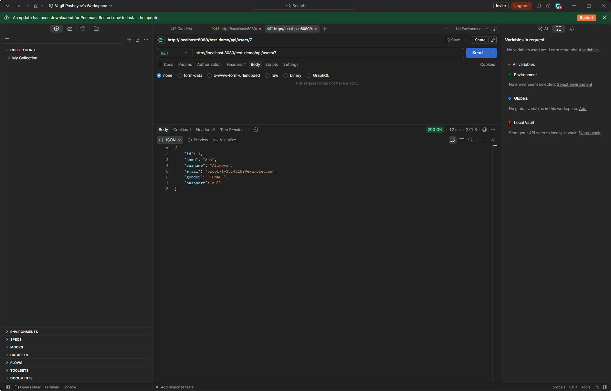
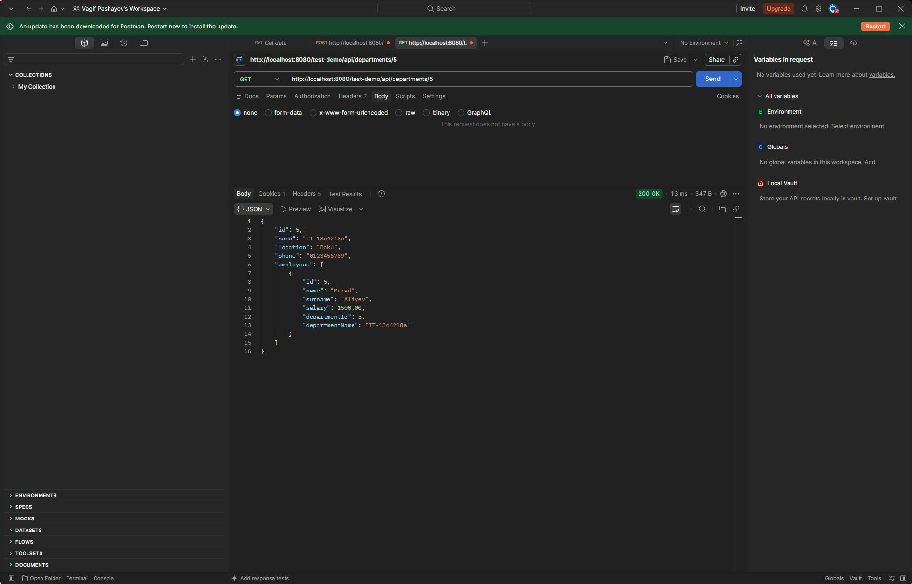
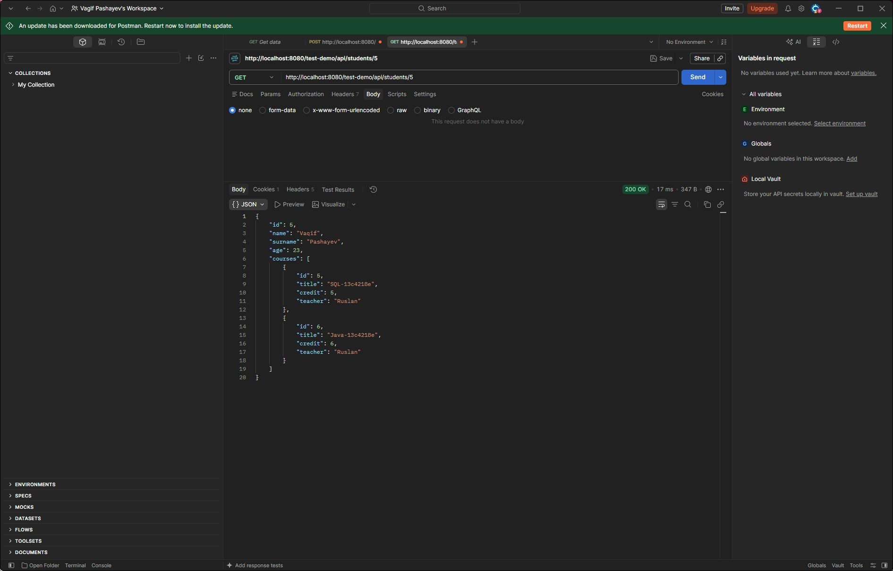
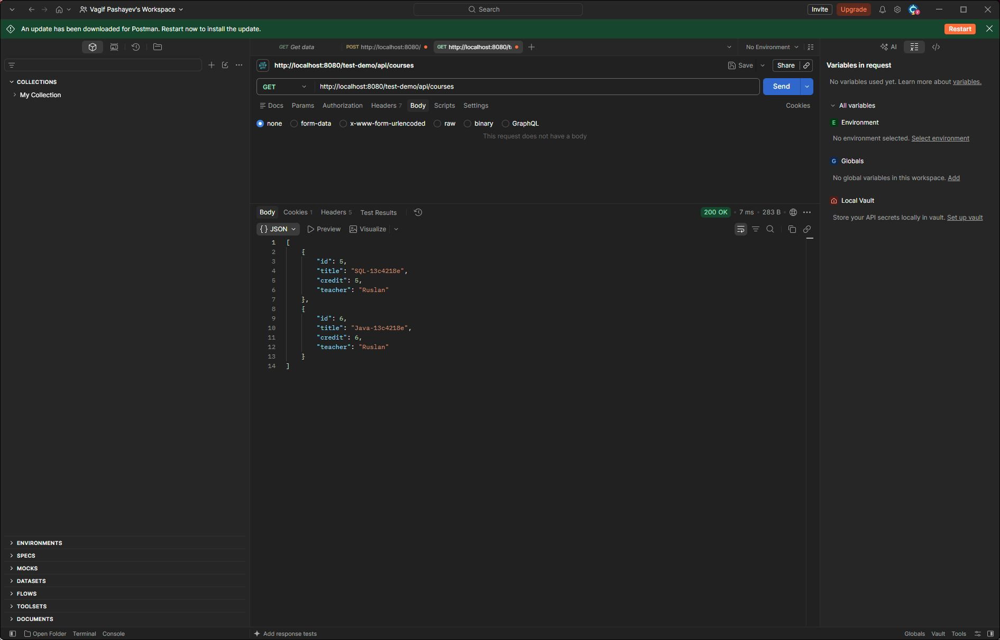
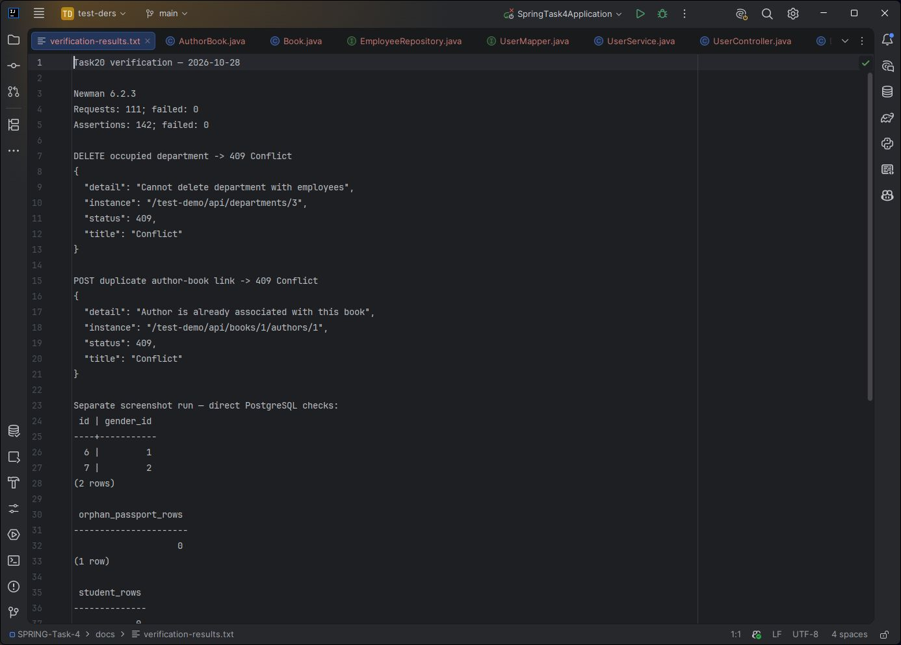
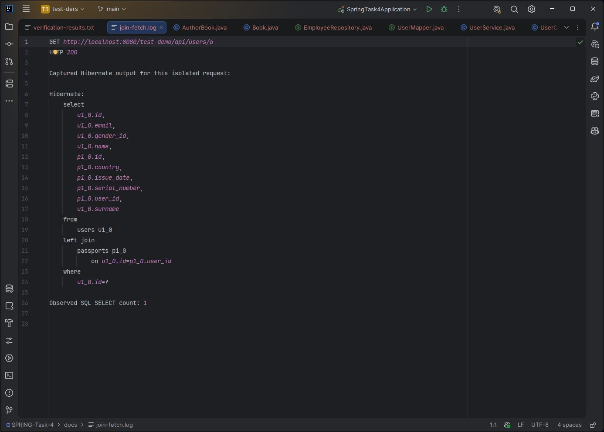

# Task20 — yoxlama nəticələri

Yoxlanılıb: 28.10.2026. Java 25, PostgreSQL 16 və işləyən HTTP API istifadə olunub.

## Ümumi nəticə

- Gradle test: Spring context uğurla açılır.
- Newman 6.2.3: 111 HTTP sorğusu, 142 assertion, 0 uğursuz nəticə.
- Əlaqələrin silinməsi HTTP cavabları ilə yanaşı PostgreSQL-də də yoxlanılıb.
- Şəkillər Postman və IntelliJ pəncərələrindən çəkilib; SQL/HTTP çıxışları ayrıca saxlanılıb.
- Newman ssenarisi ilə şəkil ssenarisi ayrı icralardır, buna görə ID-lər fərqlənir.
- Yoxlama üçün yaradılan məlumatlar şəkillər çəkildikdən sonra təmizlənib.

## 1. User və passport

User yaradılıb, sonra passport əlavə edilib. GET detail cavabında passport var.


## 2. Gender converter

Şəkil ssenarisində user 6 üçün gender_id=1, user 7 üçün gender_id=2.
JSON cavablarında uyğun olaraq MALE/FEMALE qaytarılır.
Bu yoxlamanın PostgreSQL çıxışı [verification-results.txt](verification-results.txt) faylındadır.

## 3. Orphan removal

User 7-nin passportu əlavə edilib və silinib. Sonrakı GET cavabında user qalır,
passport null olur. PostgreSQL-də həmin passport ID-si üzrə sətir sayı 0-dır.



## 4. İşçisi olan şöbə silinmir

DELETE sorğusu 409 Conflict və `Cannot delete department with employees` qaytarır.
Şöbə və işçilər dəyişməz qalır. Aşağıda şöbənin detail cavabı göstərilib.
Newman-dan alınmış faktiki 409 cavabı nəticələr faylında saxlanılıb.



Əlavə olaraq işçinin başqa şöbəyə keçirilməsi və köhnə şöbə silinəndən sonra
köçürülmüş işçinin qalması yoxlanılıb.

## 5. Student silinəndə kurslar qalır

Student 5 iki kursa yazılıb:



Student üçün DELETE 204, sonrakı GET 404 qaytarıb. SQL-də students və
student_course cədvəllərində həmin student üçün 0 sətir qalıb.
Kurs 5 və 6 isə qalır:



Ümumi kursun silinməsinin iki tələbəni saxlaması, duplicate enroll və
təkrar unenroll-un rədd edilməsi də yoxlanılıb.

## 6. Kitab, iki müəllif və təkrar əlaqə

Kitaba iki müəllif bağlanıb, detail cavabında hər ikisi var:


Eyni author-book cütü ikinci dəfə əlavə ediləndə 409 Conflict qaytarılır.
Əlaqə silindikdə author və book qalır. Müəllif silindikdə kitablar,
kitab silindikdə digər müəllif qalır. Bunlar kolleksiyada ayrıca yoxlanır.

## 7. SQL və səhv cavablarının çıxışı

Bu şəkil Newman xülasəsi, faktiki HTTP cavabları və PostgreSQL yoxlamalarının
saxlanmış çıxışını göstərir. Bu, SQL konsolunun şəkli deyil; tam çıxış
[verification-results.txt](verification-results.txt) faylında oxuna bilər.



## 8. JOIN FETCH

GET /api/users/6 ayrıca icra edilib və Hibernate çıxışı götürülüb.
User və passport bir LEFT JOIN ilə yüklənib: həmin çağırışda bir SELECT var,
əlavə passport sorğusu yoxdur.

[Əsl SQL çıxışı](join-fetch.log):



Siyahı cavablarında Student.courses və Book.authors doldurulmur.
User siyahısı və Employee maaş aralığı üçün EntityGraph əlaqələri birlikdə yükləyir.

## Təkrar yoxlama

```powershell
docker compose up -d --wait
.\gradlew.bat test
.\gradlew.bat bootRun
```

Sonra Postman kolleksiyasını bütöv Run edin və ya:
`npx newman run postman/SPRING-Task-4.postman_collection.json`.
