# Task21 yoxlama hesabatı

## Bonuslarla yenilənmiş nəticə — 02.11.2026

NESTED və avtomatik retry də tamamlanıb. [Bonus hesabatı və sətir-sətir oxuma planı](bonus/README.md).
Yekun yeni yoxlamalar:13JUnit testi,183əsasHTTP/244assertion,20bonusHTTP/25assertion,6/6isolation müqayisəsi.
Real paralel retry: salary1200; capacity1kursda1tələbə. Aşağıdakı ilkin7test nəticəsi bonuslardan əvvəlki mərhələdir.

## Yekun yoxlama — 02.11.2026

| Yoxlama | Nəticə |
|---|---|
| Gradle test + bootJar |7test,0failure,BUILD SUCCESSFUL |
| Əsas Postman kolleksiyası, Newman |183request,244assertion,0failure |
| scripts/isolation-demo.sh |D1/D2/D3,altı müqayisə PASS |
| Seed məlumatları |Altı cədvəlin sıralanmış məzmun hash-ləri dəyişməyib |
| Liquibase |32EXECUTED,6dev,v1.0,lock=false |

[Gradle log](final-gradle.log), [HTTP xülasə](final-api-summary.txt), [Newman nəticəsi](final-api-results.json),
[skript xülasəsi](isolation-demo/summary.txt), [seed müqayisəsi](final-seed-after.txt),
[constraint adları](final-schema-constraints.txt), [changelog](final-changelog.txt), [lock](final-liquibase-lock.txt).

Tətbiq edilmiş migration faylları dəyişdirilmədi. Son kodda yalnız ddl-auto validate var.
Mövcud write service metodlarında REQUIRED açıq göstərilib; əsas readOnly service annotasiyaları saxlanılıb.
Bonus NESTED/retry əlavə edilməyib. Optimistic/pessimistic locking README-də alternativ həll kimi izah olunur;
Employee-yə @Version əlavə etmək tələb olunan D2 lost update sınağını dəyişərdi.

### İlk start

30oktyabrda ayrıca boş school_task21_db üzərində32changeSet icra olundu,Previously run0 idi.
[Tam ilkin log](first-start.log), [UPDATE SUMMARY](first-start-summary.txt).
Köhnə school_db saxlanıldı; yeni schema ayrıca boş bazada yaradıldı.

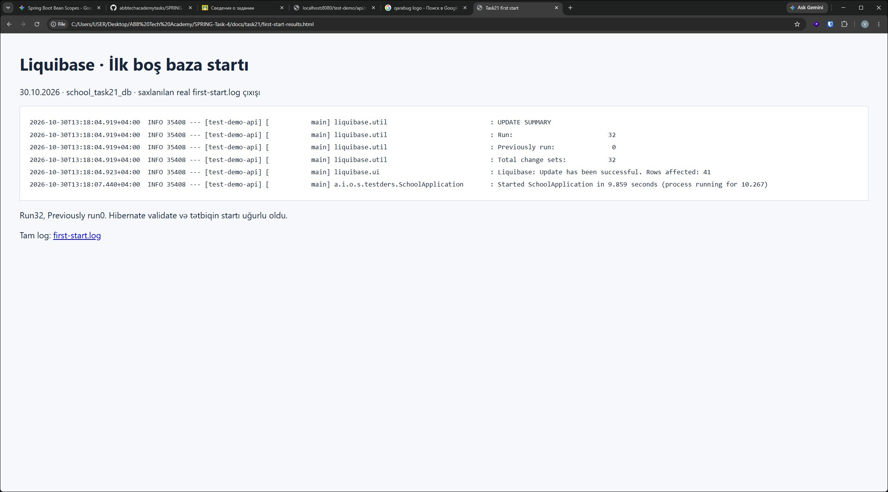

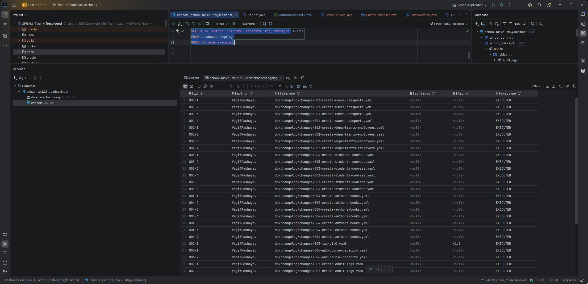

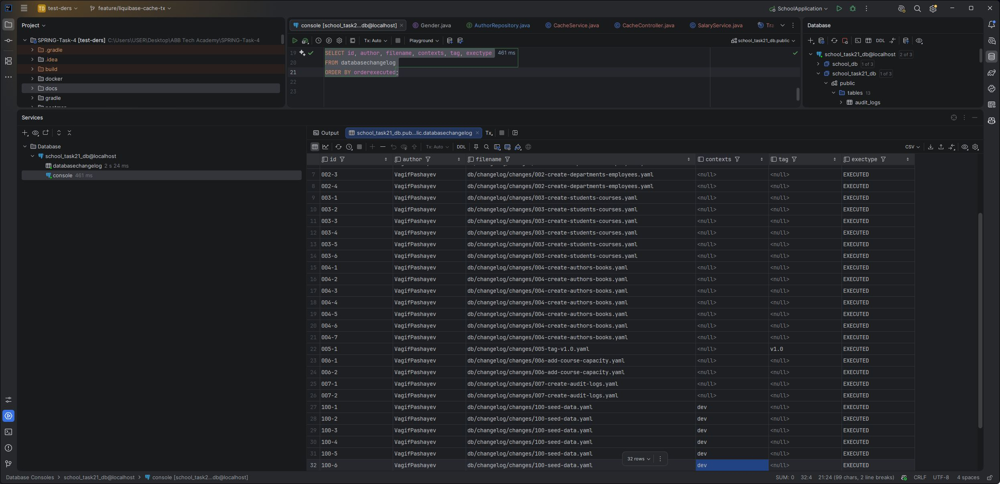

### Son paralel müqayisə

Skriptdən saxlanılan real JSON/status fayllarının [HTML hesabatı](isolation-results.html).
Bu, nəticələri oxumaq üçün hazırlanmış hesabat görünüşüdür; terminal/Postman pəncərəsi kimi təqdim edilmir.
İki ilkin oxunuşun yazılardan əvvəl baş verməsi pg_stat_activity ilə təsdiqlənir.

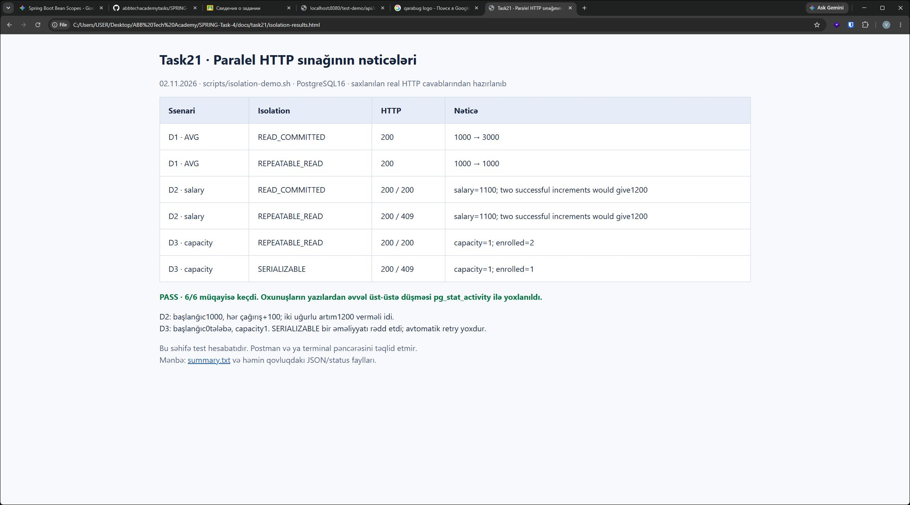

### Son propagation müqayisəsi

Müvəqqəti employee26 salary9000,department1 ilə yaradıldı. department2/+15% transfer409 oldu;
GET yenə salary9000/department1 qaytardı, audit_logs-da FAILED qaldı.
[Transfer xətası](final-transfer-failure.json), [GET](final-transfer-after.json), [audit SQL](final-transfer-audit.txt),
[MANDATORY409](final-mandatory.json), [HTTP/SQL hesabat görünüşü](propagation-results.html).
Sınaq işçisi sonra API ilə silindi; audit qeydi tarixçə kimi qaldı.

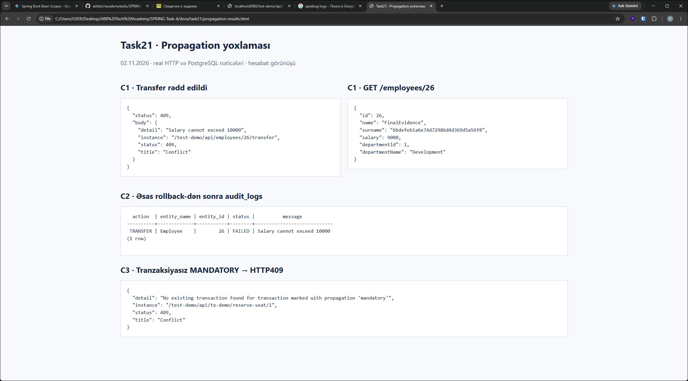

## D3 Write skew — 01.11.2026

Course1 capacity1 və ilkin qeydiyyat0. İki fərqli müvəqqəti tələbə üçün paralel POST göndərildi.
pg_stat_activity hər iki tranzaksiyanın count sorğusundan sonra açıq qaldığını təsdiqlədi; hər uğurlu cavab countBefore0 göstərdi.

| Isolation | HTTP | Capacity | Son qeydiyyat sayı |
|---|---|---:|---:|
| REPEATABLE_READ |200 və200|1|2|
| SERIALIZABLE |200 və409|1|1|

Tranzaksiyalar müxtəlif student_course sətirlərinə yazır; ortaq Course sətri yenilənmir.
RR snapshot iki müstəqil yazının birlikdə biznes qaydasını pozmasını dayandırmadı.
SERIALIZABLE təhlükəli asılılığı aşkar etdi və bir tranzaksiyanı SQLState40001 ilə rədd etdi.
Handler ConcurrencyFailureException-ı409 cavabına çevirdi. Avtomatik retry yoxdur.

[Paralel JSON](d3-parallel-results.json), [xülasə](d3-summary.txt), [transaction/SQL log](d3-transaction-boundaries.log).
Ardıcıl Postman yoxlaması11request/13assertion/0failure: RR və SERIALIZABLE uğurlu çağırışları,
dolu kurs və duplicate409, uyğun olmayan isolation və mənfi delay400, cleanup.
[HTTP nəticələri](d3-newman-results.json), [HTTP xülasəsi](d3-http-summary.txt).
Test tələbələri silindi, Course1 qeydiyyat sayı yenidən0; altı seed cədvəlinin hash-ləri dəyişmədi: [SQL](d3-seed-after.txt).
Hər iki səviyyənin nəticəsi yekun paralel hesabatda yanaşı göstərilir.

## D2 Lost update — 01.11.2026

Eyni müvəqqəti employee.salary1000 üçün iki paralel POST amount100/delay5000 göndərildi.
pg_stat_activity-də hər iki tranzaksiyanın employee-ni oxuyub açıq qaldığı təsdiqləndi; sonra yazılar başladı.

| Isolation | HTTP nəticələri | Son maaş | İzah |
|---|---|---:|---|
| READ_COMMITTED |200 və200|1100|İki çağırış da1000-dən1100 hesabladı; bir artım itdi |
| REPEATABLE_READ |200 və409|1100|PostgreSQL ziddiyyətli ikinci yazını rədd etdi |

Hər iki artım ardıcıl uğurla tətbiq edilsəydi maaş1200 olardı.
REPEATABLE_READ nəticəsində bir əməliyyat rədd edilib:1200 almaq üçün onu yeni tranzaksiyada tam təkrarlamaq lazımdır.
Bu mərhələdə avtomatik retry əlavə olunmayıb. PostgreSQL log-da SQLState40001/could not serialize access due to concurrent update var.
Spring CannotAcquireLockException-ı ConcurrencyFailureException handler-i409 ProblemDetail cavabına çevirdi.

[Paralel cavablar](d2-parallel-results.json), [xülasə](d2-summary.txt), [transaction və SQL xəta log-u](d2-transaction-boundaries.log).
Postman Isolation/D2 salary raise ardıcıl smoke run8request/11assertion/0failure verdi:
RC+RR ardıcıl1000->1100->1200; mənfi amount/delay və uyğun olmayan isolation400.
[Postman nəticəsi](d2-newman-results.json), [HTTP xülasəsi](d2-http-summary.txt).
Test employee-ləri silindi; altı seed cədvəlinin məzmun hash-ləri eynidir: [SQL](d2-seed-after.txt).

## D1 Non-repeatable read — 01.11.2026

İki ayrıca service metodu və controller switch-i istifadə olunur: READ_COMMITTED və REPEATABLE_READ.
Hər metod JPQL avg-ni oxuyur,5000ms gözləyir,sonra eyni avg sorğusunu təkrarlayır.
Sınaq üçün ayrıca müvəqqəti şöbə və maaşı1000 olan bir işçi yaradıldı; seed məlumatları dəyişdirilmədi.

Asinxron HTTP report başladıldıqdan sonra pg_stat_activity-də ilkAVG-dən sonra açıq idle-in-transaction sessiyası müşahidə olundu.
Yalnız bundan sonra paralel PUT employee maaşını3000 etdi. PUT report-dan əvvəl bitdi; report hələ gözləyirdi.

| Isolation | firstAvg | secondAvg | Writer commit cavabı | Report bitməsi |
|---|---:|---:|---:|---:|
| READ_COMMITTED |1000|3000|399ms|5088ms|
| REPEATABLE_READ |1000|1000|253ms|5014ms|

REPEATABLE_READ sınağından əvvəl maaş yenidən1000 edildi. Sonda test işçisi və şöbəsi silindi.
Altı seed cədvəlinin məzmun hash-ləri əvvəlki vəziyyətlə eynidir.
[Paralel HTTP nəticələri](d1-parallel-results.json), [xülasə](d1-summary.txt), [transaction səviyyələri](d1-transaction-boundaries.log),
[seed yoxlaması](d1-seed-after.txt).

Postman Isolation/D1 salary report qovluğu ayrıca4request/8assertion/0failure verdi:
iki səviyyə delay0 ilə200, dəstəklənməyən SERIALIZABLE və mənfi delay400.
Bu ardıcıl Postman smoke run özü parallel isolation sübutu deyil; yuxarıdakı asinxron sınaq həmin fərqi göstərir.
[Postman nəticəsi](d1-newman-results.json), [HTTP xülasəsi](d1-http-summary.txt).

## Self-invocation — 01.11.2026

Müvəqqəti olaraq raise metodu SalaryService-dən EmployeeService daxilinə köçürüldü, REQUIRES_NEW ilə işarələndi,
transfer isə this.raise çağırdı. Hər iki metodda TransactionSynchronizationManager-in cari transaction adı çıxarıldı.
Uğurlu və uğursuz transfer integration testləri ayrıca test bazasında keçdi.
Hər iki çağırışda inner və outer ad EmployeeService.transfer oldu; EmployeeService.raise üçün transaction interceptor çağırışı olmadı.
AuditLogService ayrı bean olaraq qaldığından onun REQUIRES_NEW tranzaksiyası ayrıca açıldı; bunu self-invocation ilə qarışdırmırıq.

Deməli this.raise üzərində REQUIRES_NEW annotasiyası yeni tranzaksiya yaratmadı; metod xarici tranzaksiyada işlədi.
Sonra EmployeeService əvvəlki nüsxədən bayt-bayt bərpa edildi və compileJava uğurla keçdi. İşləyən JAR dəyişdirilmədi.
[Müvəqqəti metod](self-invocation-temporary-method.txt), [test çıxışı](self-invocation-tests.log),
[trace və transaction adları](self-invocation-sql.log), [xülasə](self-invocation-summary.txt),
[bərpa hash-i](self-invocation-restoration.txt).

## C3 MANDATORY — 01.11.2026

EnrollmentService.reserveSeat ayrı bean-də MANDATORY istifadə edir. StudentService.enroll REQUIRED tranzaksiyası daxilində
onu təkrar qeydiyyat yoxlamasından sonra, student.addCourse-dan əvvəl çağırır. Demo controller-də @Transactional yoxdur.
ApiExceptionHandler IllegalTransactionStateException üçün ProblemDetail409 qaytarır.

Newman Transactions/C3 MANDATORY:12request/19assertion/0failure.

| Ssenari | Nəticə |
|---|---|
| POST /api/tx-demo/reserve-seat/1, tranzaksiya yoxdur | 409, mandatory transaction mesajı |
| Eyni demo, mövcud olmayan course ID | Yenə409, metodun içindəki findById-yə çatmır |
| Capacity1 kursa birinci tələbə, enroll REQUIRED | 201; tələbə sayı0->1 |
| Həmin dolu kursa ikinci tələbə | 409 Course is full; ikinci tələbənin courses siyahısı boşdur |
| Test tələbələri silinəndən sonra | Kursun tələbə sayı0; seed məlumatları dəyişməyib |

[Postman JSON](c3-newman-results.json), [Newman çıxışı](c3-newman.log), [xülasə](c3-summary.txt),
[transaction log](c3-transaction-boundaries.log), [seed hash-ləri](c3-seed-after.txt).
reserveSeat yalnız boş yer yoxlamasıdır; qeydiyyat student.addCourse ilə yaranır.
Bu ardıcıl yoxlama paralel sorğularda capacity aşılmasını həll etmir; həmin fərq HissəD-də ayrıca sınaqdan keçiriləcək.

## C2 REQUIRES_NEW audit — 01.11.2026

AuditLogService.log ayrı bean-də REQUIRES_NEW ilə işləyir. Transfer catch blokunda FAILED yazır və exception-u yenidən atır.
Uğurlu biznes əməliyyatında SUCCESS yazılır. İki integration test ayrıca school_task21_cache_checks bazasında keçdi.
Rollback-dən sonra birbaşa SQL employee.salary9000/department_id1 və FAILED rows1 göstərdi.
Log-da Suspending current transaction -> AuditLogService üçün yeni tranzaksiya -> commit -> Resuming suspended transaction -> əsas rollback görünür.

Müqayisədə yalnız audit annotasiyası müvəqqəti REQUIRED edildi və eyni uğursuz transfer testi yenidən işlədi.
Employee yenə köhnə vəziyyətdə qaldı, FAILED rows0 oldu. Sonra mənbə faylı ehtiyat nüsxədən bayt-bayt bərpa edildi;
son bootJar-da REQUIRES_NEW var. Changelog və DATABASECHANGELOG dəyişdirilmədi.

| Audit propagation | Employee rollback | FAILED qeydi |
|---|---|---|
| REQUIRES_NEW | var | qalır, 1sətir |
| REQUIRED | var | rollback olur, 0sətir |

[REQUIRES_NEW test çıxışı](c2-requires-new-tests.log), [SQL/transaction log](c2-requires-new-sql.log),
[REQUIRED müqayisəsi](c2-required-tests.log), [müqayisə SQL/log](c2-required-sql.log),
[mənbənin bərpası SHA256](c2-source-restoration.txt).

Son JAR-da mövcud Transactions Postman kolleksiyası Newman ilə11request/17assertion/0failure verdi.
Rollback cavabı409 oldu; ayrı GET köhnə şöbə/maaşı qaytardı; SQL isə müstəqil FAILED sətrini göstərdi.
[HTTP nəticələri](c2-http-results.json), [SQL audit sətirləri](c2-http-audit-verification.txt), [xülasə](c2-http-summary.txt).
Bu sınağın yaratdığı iki employee və yalnız onlara aid3audit sətri sübut saxlanıldıqdan sonra silindi.

## C1 REQUIRED — 01.11.2026

EmployeeService.transfer və ayrı bean olan SalaryService.raise REQUIRED istifadə edir.
Postman Transactions/C1 REQUIRED kolleksiyası Newman ilə işlədildi:11request,17assertion,0failure.

| Ssenari | Nəticə |
|---|---|
| Maaş1000, şöbə1 -> şöbə2, +15% | HTTP200; sonrakı GET salary1150/departmentId2 |
| Maaş9000, şöbə1 -> şöbə2, +15% | HTTP409 Salary cannot exceed10000; sonrakı GET salary9000/departmentId1 |
| Maaş8000, +25% | HTTP200; dəqiq10000 qəbul edildi |

Log-da transfer üçün Creating new transaction, raise üçün Participating in existing transaction görünür.
Xətada daxili REQUIRED ümumi tranzaksiyanı rollback-only etdi, xarici metoddan da xəta çıxdı və rollback icra edildi.
Department dəyişməsi Java-da artıq edilmiş olsa da commit olunmadı. Sonrakı ayrı GET köhnə şöbəni qaytardı.

[Postman kolleksiyası](../../postman/Task21-Transactions.postman_collection.json), [Newman çıxışı](c1-newman.log),
[cavablar və assertion-lar](c1-newman-results.json), [transaction sərhədləri](c1-transaction-boundaries.log),
[qısa nəticə](c1-summary.txt). Test işçiləri sonda silindi; altı seed cədvəlinin məzmun hash-ləri dəyişmədi:
[SQL yoxlaması](c1-seed-after.txt). C2 audit bu mərhələdə hələ əlavə olunmayıb.

## Hibernate L2, collection və query cache — 31.10.2026

Postman Cache kolleksiyası Newman ilə icra olundu: 26 request, 34 assertion, 0 failure.
Eyni kolleksiya Postman Desktop Collection Runner-də də işlədi: Passed34, Failed0, Errors0. Aşağıdakı şəkillər həmin real run-dan saxlanılıb, göstəricilər sonradan çəkilməyib.

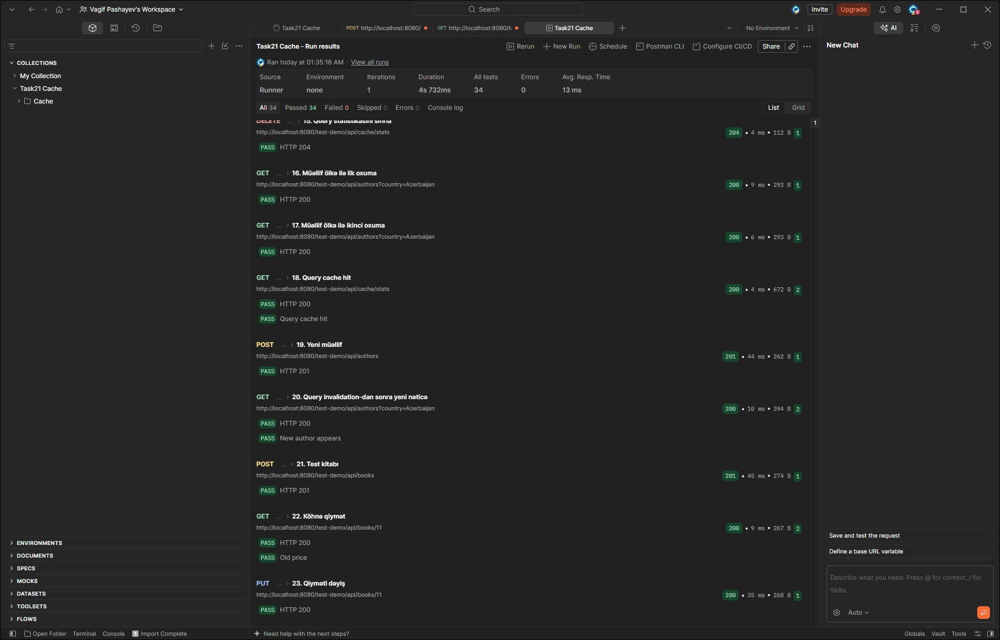

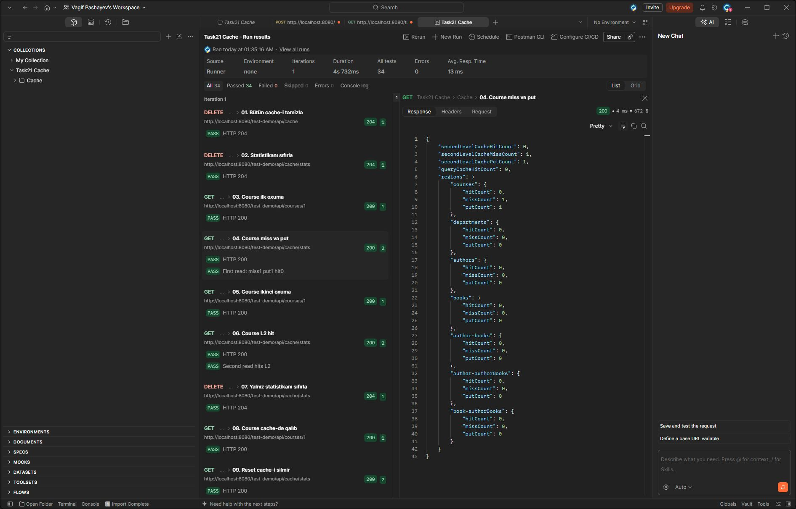

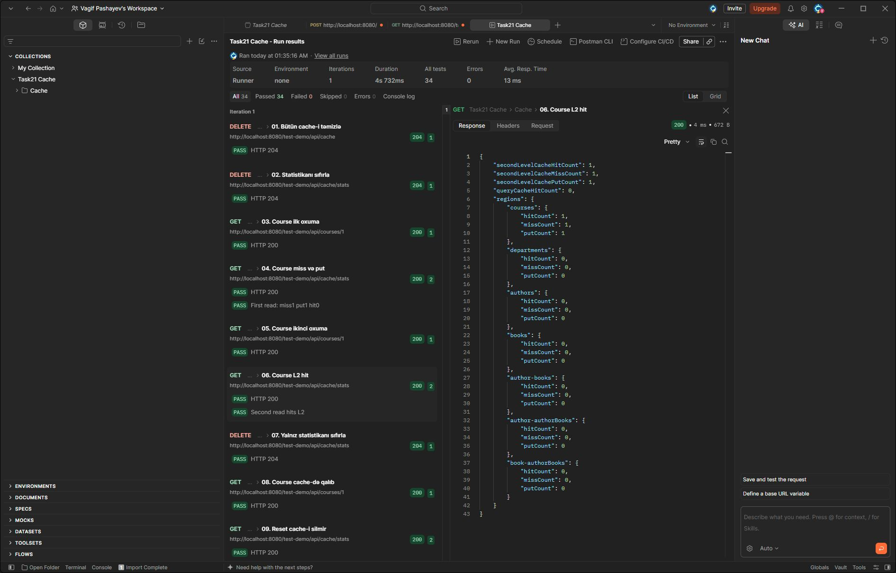

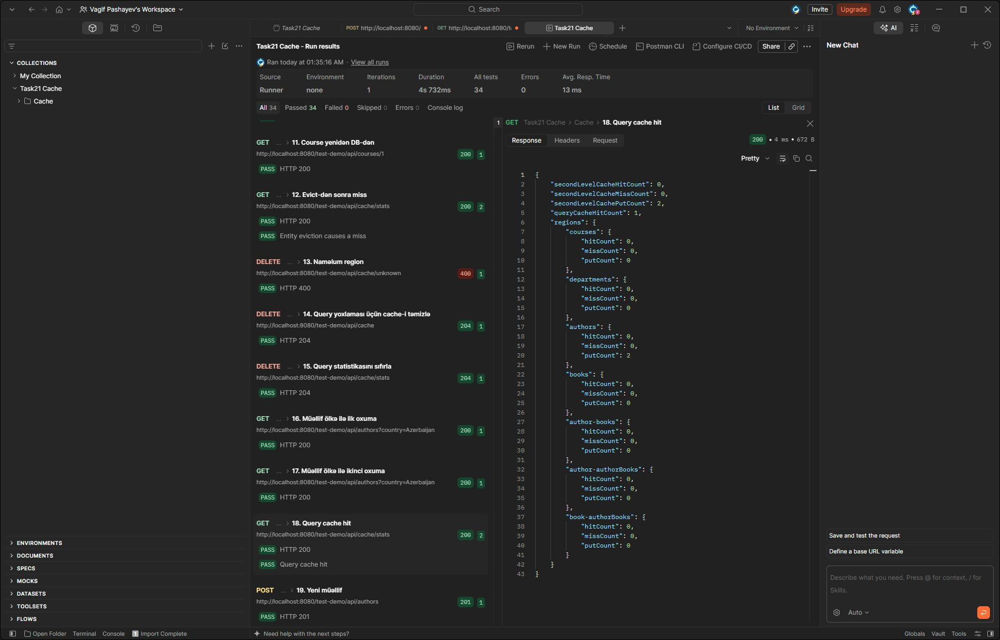

[Tam çıxış](cache-newman.log), [JSON nəticəsi](cache-newman-results.json), [əlavə HTTP və SQL sayları](cache-http-checks.json).

| Ssenari | Real nəticə |
|---|---|
| Course findById iki ayrı HTTP tranzaksiyada | İlkində miss1/put1/hit0; ikincidə hit1, yeni SELECT yoxdur |
| DELETE /cache/courses | Sonrakı oxumada yeni miss/put |
| DELETE /cache/stats | Sayğaclar sıfırlandı; Course cache-də qaldı, yeni oxuma hit verdi |
| Naməlum region | HTTP400 |
| Course JOIN FETCH | Hər iki çağırışda 1 SELECT |
| Author ölkə sorğusu | İlkində 1 SELECT; ikincidə 0, queryCacheHitCount=1 |
| Yeni Azerbaijan müəllifi | Say2->3; əvvəlki query nəticəsi invalidate olundu, yeni SELECT icra edildi |
| Book update və GET | Qiymət11.25->22.50; növbəti GET yeni qiyməti qaytardı |

HTTP sınaqlarının yaratdığı müəllif və kitab silindi; əsas seed counts authors5/books8/courses5 qaldı.

Collection və bulk üçün ayrıca school_task21_cache_checks bazasında dörd JUnit integration test keçdi.
Hər oxuma ayrıca tranzaksiyada aparıldı ki, L1 nəticəni gizlətməsin.
Author.authorBooks və Book.authorBooks ikinci tranzaksiyada L2 hit verdi və əlavə SELECT sayı0 oldu.
Book üçün birbaşa find ilə cache əvvəlcədən dolduruldu, update-dən sonra cached entry-nin invalidation-u və yeni qiymət yoxlanıldı;
beləliklə yalnız JOIN FETCH endpoint-inin nəticəsinə əsaslanmadıq.

CourseRepository.updateCredit @Modifying JPQL bulk update edir. Test əvvəl Course1 və Course2-ni cache-ə yüklədi;
yalnız Course1 dəyişdirilsə də commit-dən sonra hər ikisi region-dan çıxdı.
containsEntity yoxlamaları və növbəti miss bunu sübut etdi. Hit/put sayğacları region-un cari ölçüsü deyil;
eviction onların tarixçəsini sıfırlamır.

[JUnit nəticələri](cache-integration-summary.txt), [SQL və assertion çıxışı](cache-integration-sql.log), [Gradle çıxışı](cache-integration-tests.log).
Gradle test classloader-i classpath:ehcache.xml URI-sini tapa bilmədiyi üçün uri ehcache.xml edildi;
bu classpath resource adı ilə həm testlər, həm JAR uğurla başladı. Java25-də Ehcache3.10.8 Unsafe deprecation warning verir;
missing-region warning yoxdur.

Əlavə collection invalidation yoxlaması əvvəl EntityNotFoundException tapdı: link birbaşa repository-dən silinəndə
cached collection-da silinmiş ID qalırdı. BookService.removeAuthor indi Author.removeAuthorBook helper-i ilə hər iki
kolleksiyanı yeniləyir; orphanRemoval əlaqə sətrini silir. Test silmədən sonra da hər iki kolleksiyanın boş olduğunu
ayrı tranzaksiyada yoxlayır. Düzəlişdən sonra bütün4test yenidən uğurla keçdi.

Son yığılmış JAR-da əsas kolleksiyanın tam regression run-u:137request/176assertion/0failure.
[Qısa nəticə](full-api-summary.txt), [Newman JSON](full-api-newman-results.json).
Altı seed cədvəlinin məzmun hash-ləri əvvəlki nüsxə ilə eynidir: [SQL nəticəsi](cache-seed-after.txt).

## v1.0 rollback və update

30.10.2026 tarixində school_task21_db üçün pg_dump custom formatında ehtiyat nüsxə saxlanıldı və pg_restore --list ilə oxunması yoxlanıldı. Nüsxə Git-dən kənardadır. Tətbiq rollback-dən əvvəl dayandırıldı. Köhnə school_db bazası dəyişdirilmədi.

Əvvəl rollback-sql ilə SQL yoxlanıldı, sonra real rollback --tag=v1.0 icra edildi.

| Yoxlama | Əvvəl | Rollback-dən sonra | Update-dən sonra |
|---|---:|---:|---:|
| DATABASECHANGELOG sətirləri | 32 | 21 | 32 |
| courses.capacity | var | yoxdur | var |
| audit_logs | var | yoxdur | var |
| Kurs sayı | 5 | 0 | 5 |
| v1.0 tag qeydi | var | yoxdur | var |

Tag tagDatabase ilə yaradıldığı üçün 005-1 qeydi də rollback zamanı silindi. 001–004 sxemi qaldı. Status 11 gözləyən changeSet göstərdi. Update həmin 11 changeSet-i yenidən icra etdi.


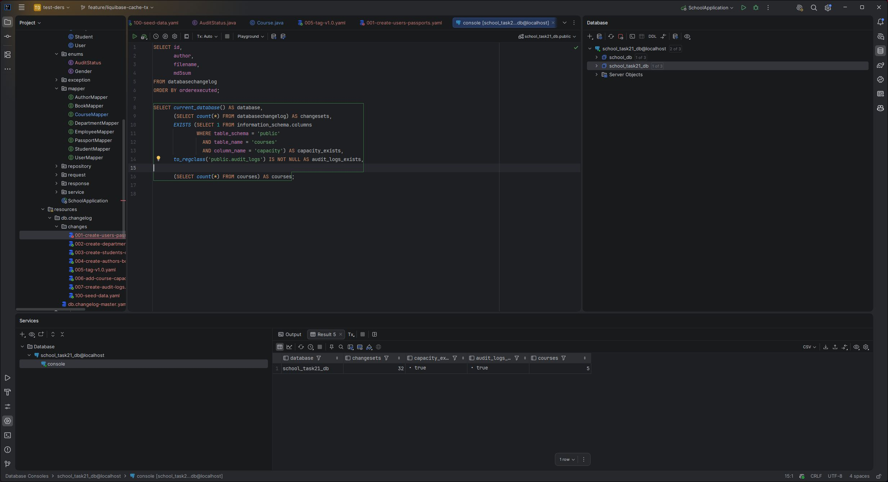

Altı seed cədvəlinin sətir sayı və sıralanmış məzmun hash-ləri əvvəlki vəziyyətlə eynidir. Course 1 capacity=1, digər dörd kurs capacity=30; lock=false. Hibernate validate keçdi, tətbiq başladı, GET /test-demo/api/courses cavabı 200 və 5 kurs oldu.

Saxlanılan sübutlar: [əvvəl](rollback-before.txt), [rollback](rollback-after.txt), [bərpa](rollback-restored.txt), [SQL preview](liquibase-rollback-preview.log), [rollback log](liquibase-rollback.log), [update log](liquibase-update.log), [son status](liquibase-status-restored.log), [tətbiqin startı](rollback-restored-app.log), [HTTP](rollback-http.txt). Məlumat müqayisəsi: [əvvəl](rollback-data-before.txt), [sonra](rollback-data-restored.txt).

## Hibernate validate yoxlaması

30.10.2026 tarixində Course entity-sində yalnız @Column adı müvəqqəti olaraq capacity_missing edildi. Bazada courses.capacity saxlanıldı, changelog faylları dəyişdirilmədi.

Liquibase bazanın aktual olduğunu göstərdi: Run 0, Previously run 32. Hibernate isə aşağıdakı xəta ilə tətbiqin başlamasını dayandırdı:

```text
Schema validation: missing column [capacity_missing] in table [courses]
```

Şəkil IntelliJ Run konsolunda real uğursuz startı və həmin vaxtkı müvəqqəti annotasiyanı göstərir. DevTools ilə IDE prosesi exit code 0 göstərə bilər; bu, Spring kontekstinin uğurla başlaması demək deyil. Eyni yoxlamanın ayrıca JAR startı exit code 1 ilə bitdi; tam çıxış [hibernate-validate-error.log](hibernate-validate-error.log) faylındadır.

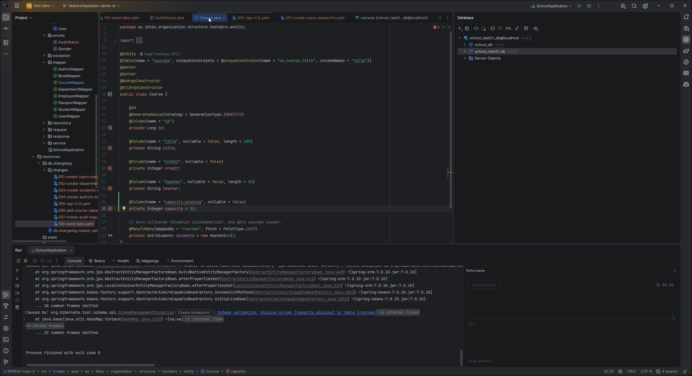

Yoxlamadan sonra annotasiya yenidən capacity olaraq qaytarıldı. Bazada heç bir sütun və ya məlumat silinmədi.

Yenidən yığılan JAR uğurla başladı. Liquibase Run 0 / Previously run 32 göstərdi, Hibernate validate keçdi. GET /test-demo/api/courses cavabı 200 və 5 kurs oldu. Uğurlu startın çıxışı [hibernate-validate-restored.log](hibernate-validate-restored.log) faylındadır.

## Liquibase checksum yoxlaması

001-1 changeSet-də users.name tipi müvəqqəti olaraq VARCHAR(50)-dən VARCHAR(51)-ə dəyişdirildi. Bu changeSet artıq bazada icra olunmuşdu.

IntelliJ-də start zamanı Liquibase ValidationFailedException verdi. Köhnə checksum 9:231f6a33b969c53d3caa0ee2c4f7618a, dəyişdirilmiş məzmunun checksum-u isə 9:c283abb9a65777ee35ccf0d06580d8bd oldu. Liquibase fərqi aşkarlayıb startı dayandırdı; sütunun tipi bazada dəyişmədi.

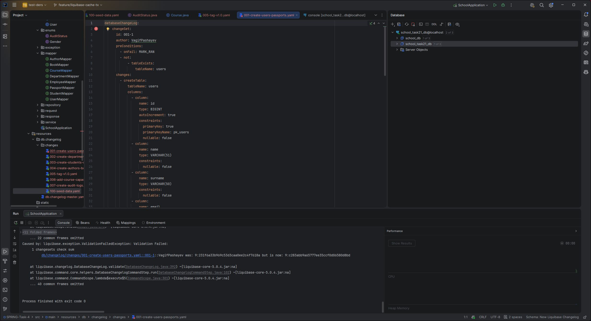

Şəkil real IntelliJ Run konsolunu və həmin vaxtkı VARCHAR(51) dəyişikliklərini göstərir. Eyni ssenarinin ayrıca JAR startı exit code 1 ilə bitdi: [tam xəta çıxışı](liquibase-checksum-error.log).

Sonra fayl yoxlamadan əvvəlki nüsxədən bayt-bayt bərpa edildi. clear-checksums işlədilmədi, DATABASECHANGELOG dəyişdirilmədi. Yenidən yığılan tətbiq uğurla başladı, Liquibase Run 0 / Previously run 32 göstərdi; GET /test-demo/api/courses cavabı 200 və 5 kurs oldu.

[Bərpadan sonrakı start](liquibase-checksum-restored.log) və [SQL nəticələri](checksum-verification.txt) saxlanılıb. users.name uzunluğu 50, changeSet sayı 32 və ilkin checksum olduğu kimi qaldı.
