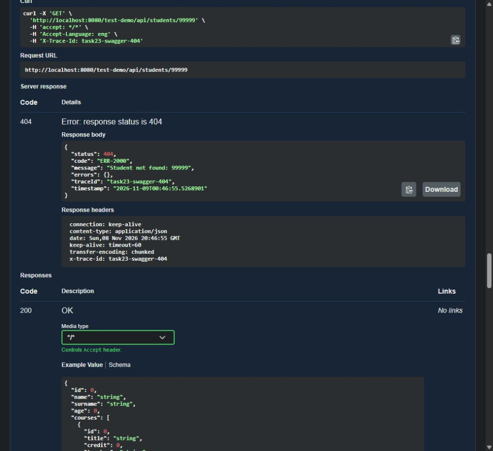
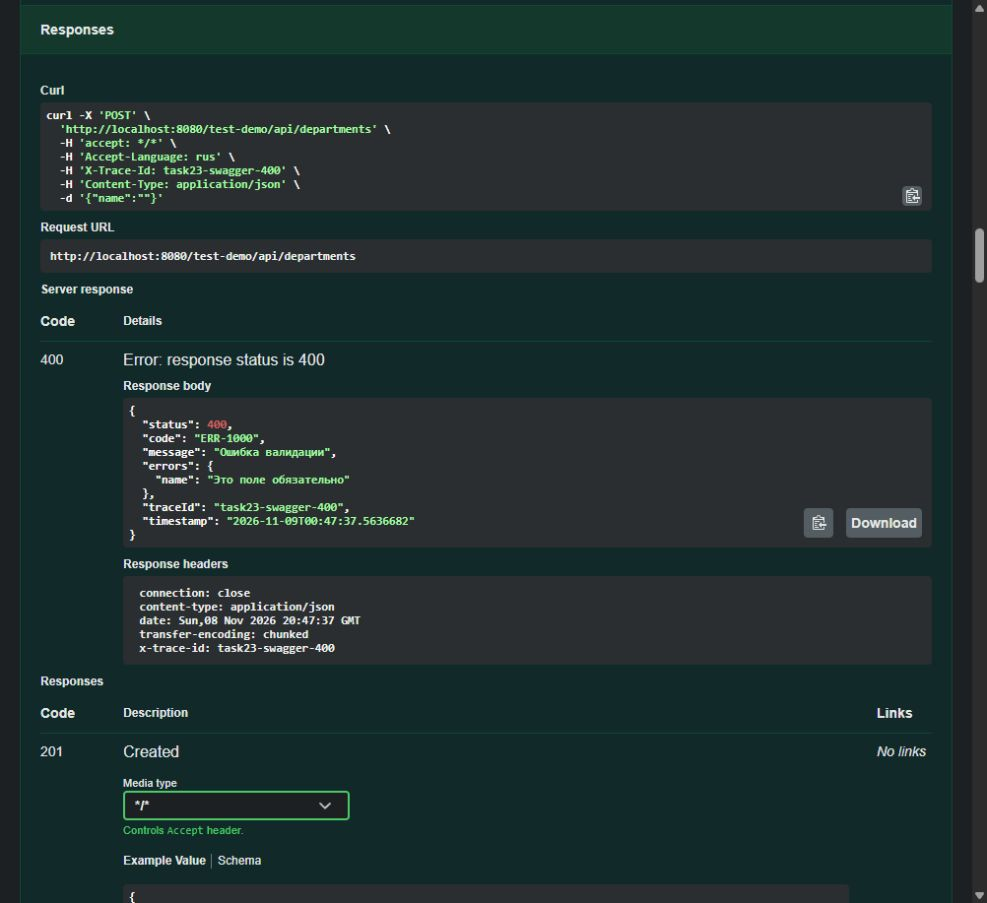

# Tapşırıq 23

AOP, Trace ID, lokalizasiya, xəta cavabları, validasiya və Swagger.

## Başlatmaq

Layihənin kökündəki README-də Java 25, Docker və baza parametrləri var.
`./gradlew bootRun` başladıqdan sonra:

- Swagger: http://localhost:8080/test-demo/swagger-ui.html
- OpenAPI: http://localhost:8080/test-demo/v3/api-docs
- API: http://localhost:8080/test-demo/api

## Görülən işlər

| Hissə | Nəticə | PR |
|---|---|---|
| ErrorCode və i18n | 33 tələb olunan kod, əvvəlki Task21 üçün 13 əlavə kod, 3 bundle | [#2](https://github.com/abbtechacademytasks/SPRING-Task-4/pull/2) |
| Exception handler | Vahid ErrorResponse, MVC/DB və biznes xətaları, 4xx WARN, 5xx ERROR | [#3](https://github.com/abbtechacademytasks/SPRING-Task-4/pull/3) |
| Validasiya | Request DTO-lar, enum açarları, @Valid, @AzPhoneNumber | [#4](https://github.com/abbtechacademytasks/SPRING-Task-4/pull/4) |
| Trace ID | Header yoxlanır, MDC, response header, finally ilə təmizləmə | [#5](https://github.com/abbtechacademytasks/SPRING-Task-4/pull/5) |
| AOP | Controller INFO, service DEBUG, vaxt, giriş/çıxış/xəta, arqumentlərin gizlədilməsi | [#6](https://github.com/abbtechacademytasks/SPRING-Task-4/pull/6) |
| Swagger | 7 tag, 64 əməliyyat, headers, 400/404/409/500, ErrorResponse schema və kod cədvəli | feature/swagger |

PR-lər bir-birindən asılıdır: #2 əvvəlki Task21 branch-ına, hər növbəti PR əvvəlkinə açılıb.
Beləliklə hər PR yalnız öz hissəsini göstərir. Main-ə merge edilməyib.

## Yoxlamalar

- Gradle: 13 test, 0 xəta; bootJar yığılır.
- Newman: 28 HTTP sorğusu, 126 assertion, 0 xəta. [Kolleksiya](../../postman/Task23-Infrastructure.postman_collection.json), [nəticə](newman-summary.json), [log](newman.log).
- OpenAPI: 64 əməliyyatın hamısında summary/description, iki header və dörd xəta cavabı yoxlanıb. ErrorResponse-un 6 sahəsi təsvir olunub, cədvəldə 46 kod var.
- [HTTP cavabları](checks.json): 3 dil və alias-lar, query prioriteti, fallback, bütün modullarda 404, validation, malformed JSON, enum, type mismatch, missing parameter, 405, unknown URL və Trace ID.
- Əlavə lokal yoxlamalar: handler üçün 25 MockMvc sorğusu; validation üçün 30 MockMvc + 14 phone case; filter üçün 14 case; AOP üçün real proxy ilə result/exception identity, tək proceed, səviyyələr və masking. Bunlar ayrıca HTTP sorğuları kimi sayılmır.
- `Exception("...` ilə atılan xəta qalmayıb. Enum-dakı bütün açarlar 3 bundle-da var.

HTTP kolleksiyası yalnız tapılmayan resursları və rədd olunan request-ləri yoxlayır, uğurlu yazma/silmə etmir.
Gradle inteqrasiya testləri ayrıca test bazasından istifadə edir.

```powershell
newman run postman/Task23-Infrastructure.postman_collection.json
Select-String -Path logs/app.log -Pattern 'task23-swagger-404'
```

Bir sorğunun controller, service və handler logları: [trace-example.log](trace-example.log).

## Swagger yoxlaması

GET `/api/students/99999`, `Accept-Language: eng`, `X-Trace-Id: task23-swagger-404`.
404, ERR-2000, ingiliscə mesaj. Header və body-də eyni ID.



POST `/api/departments`, body `{"name":""}`, `Accept-Language: rus`.
400, ERR-1000, rusca errors.name. Baza yazısı yaranmır.



## Qeydlər

- Şifrə/token kimi məlumatları loglamamaq üçün bütün String və DTO arqumentləri gizlədilir. Rəqəm ID-lər görünür.
- Passport serial üçün TЗ ayrıca milli format vermir: 20 simvola qədər latın hərfi, rəqəm və defis qəbul edilir.
- Phone validator boşluqları nəzərə almır; mapper saxlamadan əvvəl onları silir.
- Swagger-də köhnə cache/isolation/transaction əməliyyatları da saxlanılıb. 7 əsas tag qorunur; ortaq cache əməliyyatları aid olduğu bölmələrdə təkrar görünə bilər.
- Swagger nümunələri sənədləşmə üçündür. Real status, dil və Trace ID handler/resolver/filter tərəfindən hazırlanır.
- Bonus cədvəli ErrorCode.values()-dan qurulur. Yeni kod əlavə ediləndə tətbiq yenidən başladılmalıdır.
